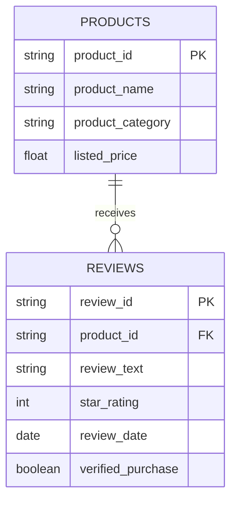

# Review-Informed Skincare Product Discovery Using NLP and Data Analytics

## Project Overview

This project proposes using Python-based data analysis and Natural Language Processing (NLP) to examine skincare-related product reviews alongside star ratings. The goal is to identify recurring feedback themes—such as texture, fragrance, packaging, value for money, delivery, and perceived product performance—and present them as interpretable summaries.

The initial scope is **review analysis and customer-feedback discovery**. It is not a production recommendation engine, medical assessment, or customer-churn prediction system.

## Business Problem

Average star ratings compress different customer experiences into one number. Written reviews may explain the reasons behind those ratings, but manually reading large volumes of feedback can be slow and inconsistent.

**Problem question:** How can product ratings and written reviews be organized into useful summaries of customer feedback across skincare-related product categories?

## Why This Problem Matters

NIQ's 2025 report on Indian beauty discusses ingredient transparency and digital discovery, including the influence of ratings and reviews on online beauty purchase decisions. Its e-beauty report also describes the importance of online channels in India's beauty market. These sources support the relevance of studying digital beauty feedback; they do **not** prove that this project will increase sales.

- NIQ, *The New Face of Indian Beauty* (2025): https://nielseniq.com/global/en/insights/report/2025/the-new-face-of-indian-beauty/
- NIQ, *The Digital Makeover: E-Beauty Trends in India* (2025): https://nielseniq.com/global/en/insights/report/2025/the-digital-makeover/

## Research Questions

1. Which words, phrases, and topics occur most often in the selected skincare-related reviews?
2. Do common themes differ across product categories, if the selected dataset contains reliable category labels?
3. How do themes in lower-rated reviews compare with themes in higher-rated reviews?
4. If sentiment analysis is attempted, how closely do automated labels agree with a manually reviewed sample?
5. Which recurring feedback themes could justify further investigation by a product, content, or customer-support team?

These questions are exploratory. The project will not assume what the data will show.

## Proposed Data Source and Evidence

A promising candidate is the **Amazon Reviews'23 “All_Beauty” category** published by McAuley Lab. The dataset documentation reports approximately **701.5K ratings/reviews, 112.6K items, and 632.0K users** for this category. These are published source-level statistics, not results produced by this project. “All_Beauty” is broader than skincare, so the product metadata must be inspected and a defensible skincare-related subset selected before making skincare-specific claims.

- Dataset overview: https://amazon-reviews-2023.github.io/main.html
- Dataset card: https://huggingface.co/datasets/McAuley-Lab/Amazon-Reviews-2023
- McAuley Lab dataset page: https://mcauleylab.ucsd.edu/public_datasets/amazon_demo/

**Important data-access note:** this dataset is large. The project should begin with a documented sample or relevant subset rather than attempting to load the full corpus at once. Before downloading, redistributing, or committing any data to GitHub, check the dataset's current terms, source requirements, and permitted use. Do not assume public availability means unrestricted redistribution.

## Proposed Workflow

1. Confirm the dataset is suitable and review its documentation, terms, fields, and limitations.
2. Inspect metadata to identify skincare-related products; document the selection rules.
3. Load a manageable sample and inspect data types, missing values, duplicates, rating range, review length, languages, and product/category coverage.
4. Clean text conservatively, preserving negation such as “not”; keep the original review text unchanged.
5. Perform exploratory data analysis (EDA): review counts, rating distribution, category counts, and review-length distribution.
6. Explore frequent words/phrases and TF-IDF features; inspect example reviews before assigning themes.
7. If sentiment analysis is used, manually label a sample and report disagreements as well as agreement.
8. Report sample sizes, limitations, and reproducible decisions; do not make causal, medical, or unsupported financial claims.

## Proposed Data Model

The fields are a proposed schema. The actual dataset schema must be checked before coding. Reviewer identifiers are not required for the first analysis and should be excluded unless there is a clear, justified need.

## Initial Analysis Plan

| Analysis | Variables | Output | Quality check |
|---|---|---|---|
| Dataset profile | rows, columns, IDs, categories | data dictionary and coverage summary | document exclusions and missingness |
| Rating distribution | star rating, product/category | counts, median/mean where appropriate, bar chart | include group sizes; ratings are ordinal |
| Review volume | product ID, category | review counts and top-level distributions | note heavily represented products |
| Text length | review text | character/word count distribution | inspect empty and extremely short reviews |
| Theme exploration | cleaned text, category, rating band | frequent terms/phrases, TF-IDF tables | inspect context; terms alone do not establish a theme |
| Sentiment validation | review text, manual label, predicted label | confusion matrix or agreement summary | report sample-selection method and disagreements |

The first stage is descriptive. Statistical tests or predictive models should be considered only if the data structure and sample sizes justify them.

## Potential Business Value and ROI

The analysis could help a retailer prioritize which recurring customer concerns deserve further investigation. For example, the project may quantify how often a theme appears in the analysed sample and compare its frequency across products or rating groups. This is an **analysis output**, not proof that a product is defective or that customers in general share the same view.

A future business evaluation could track a pre-defined operational measure, such as the rate of packaging-related support contacts per 1,000 orders, before and after a documented intervention. If financial benefits and costs can be credibly estimated, ROI can be calculated as:

**ROI (%) = (Measured financial benefits − Total costs) / Total costs × 100**

Potential costs include analyst time, software, investigation, and implementation. Potential benefits must be measured rather than assumed. A simple before/after comparison does not by itself prove causation; promotions, seasonality, pricing, order volume, and other changes may affect the result. No ROI, sales uplift, or retention improvement is claimed in this proposal.

## Implementation Challenges and Mitigations

| Challenge | Why it matters | Planned response |
|---|---|---|
| Broad “All_Beauty” category | May contain non-skincare products | inspect metadata and document inclusion rules |
| Missing text or ratings | reduces usable records | quantify missingness and document exclusions |
| Duplicate or near-duplicate reviews | can distort counts | check IDs and normalized text; avoid over-aggressive deletion |
| Unequal product review counts | can skew comparisons | report sample sizes and avoid ranking products on tiny samples |
| Sarcasm, mixed sentiment, spelling errors | can mislead simple NLP | manually inspect examples and report limitations |
| Self-selection and platform bias | reviewers may not represent all buyers | limit conclusions to the dataset and platform |
| Large dataset size | can exceed local memory/time | start with a reproducible sample; record sampling method |
| Licence and redistribution | source may impose conditions | review current terms; do not upload raw data without permission |

## Tools

- Python, Pandas, NumPy
- Matplotlib and Seaborn
- scikit-learn for count-based text features and TF-IDF
- Jupyter Notebook
- Optional text-preprocessing tools only if justified by the data

## Repository Contents

- `README.md` — project overview, research questions, workflow, ROI approach, and limitations.
- `research/dataset_source_comparison.md` — candidate-source comparison and selection recommendation.
- `research/references.md` — industry and technical references.
- `data/README.md` — dataset handling, licensing, and privacy notes.
- `report/` — place the final Week 1 report here; keep the README filenames synchronized with the actual uploaded files.

## Current Status

**Week 1 proposal / preparation for Week 2 data sourcing.** The published dataset statistics above come from the dataset documentation. They are not counts computed from a downloaded project dataset. No project-specific exploratory results, trained model, accuracy score, ROI, or business impact have been measured yet.

## References

See [`research/references.md`](research/references.md) and [`research/dataset_source_comparison.md`](research/dataset_source_comparison.md) for source links, comparison criteria, and selection caveats.
