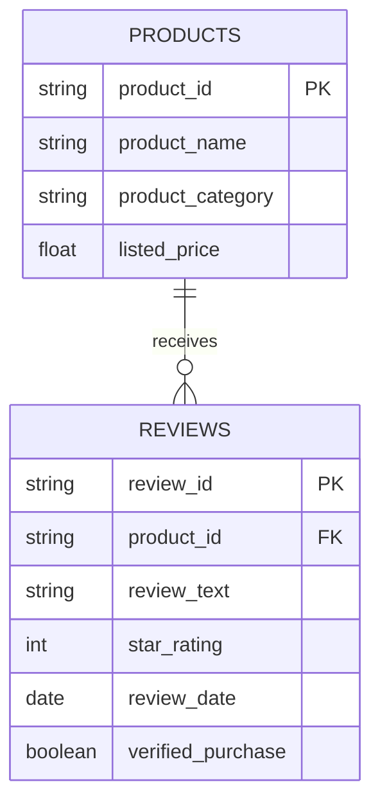

# Review-Informed Skincare Product Discovery Using NLP and Data Analytics

## Project Overview

This Week 1 proposal asks how an online skincare retailer can make customer feedback easier to understand by looking at review text alongside star ratings. Ratings give a quick score, but written reviews can explain what customers are talking about: texture, scent, packaging, value, delivery, or perceived product performance.

The initial scope is **review analysis and product discovery**, not a production recommendation engine or customer churn prediction system.

## Business Problem

How can product ratings and written reviews be organized into useful summaries of customer feedback across skincare categories?

Average star ratings provide a quick overview of customer satisfaction, but they may not explain the reasons behind customer opinions. Written reviews can reveal recurring feedback about texture, fragrance, packaging, value for money, delivery, and perceived product performance.

## Potential Business Value and ROI

The proposed analysis could help a skincare retailer identify recurring customer concerns and decide which product descriptions, packaging issues, or customer-support topics require further investigation.

The potential business value may include more efficient review analysis, clearer summaries of customer feedback, and better-informed product or customer-experience decisions.

Return on Investment (ROI) could be evaluated in a future implementation by comparing documented financial benefits with the total costs of analysis and any resulting changes.

**ROI (%) = (Financial Benefits − Total Costs) / Total Costs × 100**

No numerical ROI, sales increase, or customer-retention improvement is claimed at this stage because no dataset has been analysed and no business outcomes have been measured.

## Research Questions

- Which words, phrases, and topics appear most often in available skincare reviews?
- Do topics differ across categories such as cleanser, moisturizer, sunscreen, and serum?
- How do lower-rated reviews differ from higher-rated reviews?
- Does a simple sentiment method agree with a manually checked sample?
- Which patterns might justify further investigation by a product or customer-support team?

## Proposed Workflow

1. Verify dataset source, licence, fields, and coverage.
2. Inspect missing values, duplicate records, ratings, and category coverage.
3. Explore rating and review distributions with Pandas and visualization libraries.
4. Prepare text and examine common terms or TF-IDF features.
5. If suitable, test a simple sentiment method against manually checked examples.
6. Report observations and limitations without making causal or medical claims.

## Proposed Data Model

The fields shown are a proposed schema, not confirmation that the final dataset contains them. The first analysis does not require customer identifiers.

## Tools

- Python, Pandas, NumPy
- Matplotlib and Seaborn
- scikit-learn for count-based text features and TF-IDF
- Jupyter Notebook
- Optional text-preprocessing library if needed

## Repository Contents

- `README.md` — overview and workflow.
- `report/Week1_Review_Informed_Skincare_Analysis_Muppur_Gnaneswar_REVIEWED.docx` — reviewed editable report.
- `report/Week1_Review_Informed_Skincare_Analysis_Muppur_Gnaneswar_REVIEWED.pdf` — reviewed PDF report.
- `research/references.md` — industry, technical, and academic sources.
- `data/README.md` — dataset requirements and usage precautions.

## Current Status

**Week 1: problem definition and research plan.** No dataset has been analyzed, no model has been trained, and no business impact is claimed. The next step is to confirm the topic and dataset requirements with the internship mentor.

## References

See [`research/references.md`](research/references.md) for industry sources, scikit-learn documentation, and an academic paper on aspect-level sentiment analysis.
